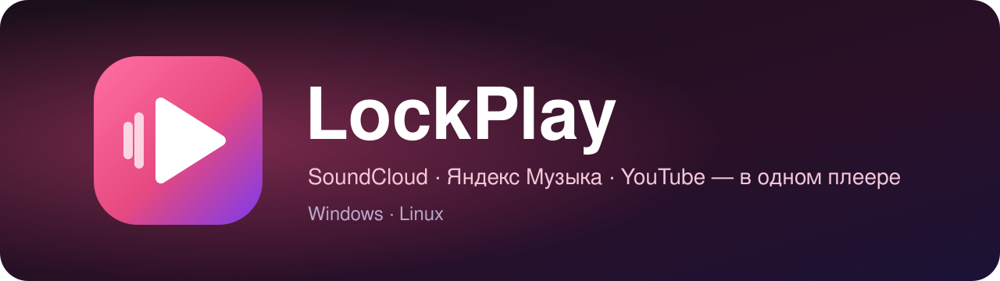

<p align="center">
  
</p>

<p align="center">
  <a href="https://github.com/lokk1q/lockplay-releases/releases/latest"></a>
  <a href="https://github.com/lokk1q/lockplay-releases/releases"></a>
  <a href="https://t.me/lockplay_off"></a>
</p>

<p align="center">
  Десктопный плеер для SoundCloud, Яндекс Музыки и YouTube.<br>
  Без рекламы, с эквалайзером, темами, текстами песен и «Моей волной».
</p>

<p align="center">
  <a href="https://github.com/lokk1q/lockplay-releases/releases/latest/download/LockPlay-windows.zip"><b>⬇ Скачать для Windows</b></a>
  &nbsp;·&nbsp;
  <a href="https://github.com/lokk1q/lockplay-releases/releases/latest/download/LockPlay-x86_64.AppImage"><b>⬇ Скачать для Linux (AppImage)</b></a>
</p>

---

## Что умеет

| | |
|---|---|
| 🔎 **Поиск везде** | SoundCloud, Яндекс Музыка (через свой аккаунт) и YouTube — переключатель прямо в строке поиска |
| 🌊 **Моя волна** | бесконечный поток под твой вкус, плюс «Плейлист дня» и «Открытия недели» |
| ❤️ **Медиатека** | лайки, плейлисты, подписки и история хранятся у тебя на компьютере; импорт лайков с SoundCloud по ссылке на профиль |
| 🎚️ **Эквалайзер** | 10 полос с пресетами, меняется на лету без щелчков |
| ⏩ **Скорость** | от 0.5× до 2×, плавно; speed up / slowed или с сохранением тона |
| 🎤 **Тексты песен** | синхронизированные, сами едут под музыку |
| 🎨 **Оформление** | темы (готовые и свои, можно делиться файлом), свои цвета и шрифты, фото / GIF / видео на фоне, свой CSS |
| 👤 **Профиль** | аватарка и баннер (можно GIF), статистика прослушиваний |
| 💬 **Discord** | трек, обложка и полоса времени в статусе |
| 🔄 **Автообновление** | плеер сам предложит новую версию и покажет, что изменилось |
| 🌍 **Языки** | русский и английский |

## Установка

### Windows
1. Скачай [`LockPlay-windows.zip`](https://github.com/lokk1q/lockplay-releases/releases/latest/download/LockPlay-windows.zip).
2. Распакуй в любую папку (например, `Документы\LockPlay`).
3. Запусти `LockPlay.exe`. Если Windows покажет «Система Windows защитила ваш компьютер» — «Подробнее» → «Выполнить в любом случае» (у плеера нет платной подписи кода).

### Linux
1. Скачай [`LockPlay-x86_64.AppImage`](https://github.com/lokk1q/lockplay-releases/releases/latest/download/LockPlay-x86_64.AppImage).
2. Сделай файл исполняемым и запусти:
   ```bash
   chmod +x LockPlay-x86_64.AppImage
   ./LockPlay-x86_64.AppImage
   ```
Нужен дистрибутив с glibc 2.39 или новее: Ubuntu 24.04+, Mint 22+, Debian 13, Fedora 40+, Arch и т. п.
Для визуализатора на Linux поставь `cava`.

## Частые вопросы

<details>
<summary><b>Нужен ли аккаунт SoundCloud?</b></summary>

Нет. Лайки, плейлисты и подписки хранятся локально. Свои лайки с SoundCloud можно перенести: «Любимые» → «Импорт» → ссылка на профиль (лайки должны быть открыты).
</details>

<details>
<summary><b>Как подключить Яндекс Музыку?</b></summary>

Настройки → Источники → Яндекс Музыка → «Войти через браузер», войди в аккаунт и вставь в поле адрес страницы, куда тебя перекинет. Полные треки — с подпиской Плюс, без неё Яндекс отдаёт отрывки по 30 секунд. Токен хранится только на твоём компьютере.
</details>

<details>
<summary><b>YouTube пишет «подтвердите, что вы не бот»</b></summary>

Так бывает с VPN. Попробуй другой VPN или включи «Вход из браузера» в Настройки → Источники → YouTube (лучше браузер со вторым аккаунтом — YouTube может ограничить аккаунт за сторонний плеер).
</details>

<details>
<summary><b>Где хранятся мои данные?</b></summary>

Windows: `%LOCALAPPDATA%\lockplay`, Linux: `~/.local/share/lockplay`. Обновления эту папку не трогают.
</details>

<details>
<summary><b>Нашёл баг / есть идея</b></summary>

Пиши в [Issues](https://github.com/lokk1q/lockplay-releases/issues) или в [Telegram-канал](https://t.me/lockplay_off).
</details>

---

<details>
<summary><b>English</b></summary>

**LockPlay** is a desktop player for SoundCloud, Yandex Music and YouTube with My Wave, a 10-band equalizer, smooth speed control, synced lyrics, themes, GIF/video backgrounds, Discord status and self-updates. The interface is available in English (Settings → Appearance → Language).

- **Windows:** download [`LockPlay-windows.zip`](https://github.com/lokk1q/lockplay-releases/releases/latest/download/LockPlay-windows.zip), unzip, run `LockPlay.exe`.
- **Linux:** download [`LockPlay-x86_64.AppImage`](https://github.com/lokk1q/lockplay-releases/releases/latest/download/LockPlay-x86_64.AppImage), `chmod +x` it and run (glibc ≥ 2.39).

Your library is stored locally; no SoundCloud account is needed.
</details>

<sub>LockPlay не связан с SoundCloud, Яндексом или Google. Названия сервисов принадлежат их владельцам. Шрифт Unbounded — SIL Open Font License.</sub>
